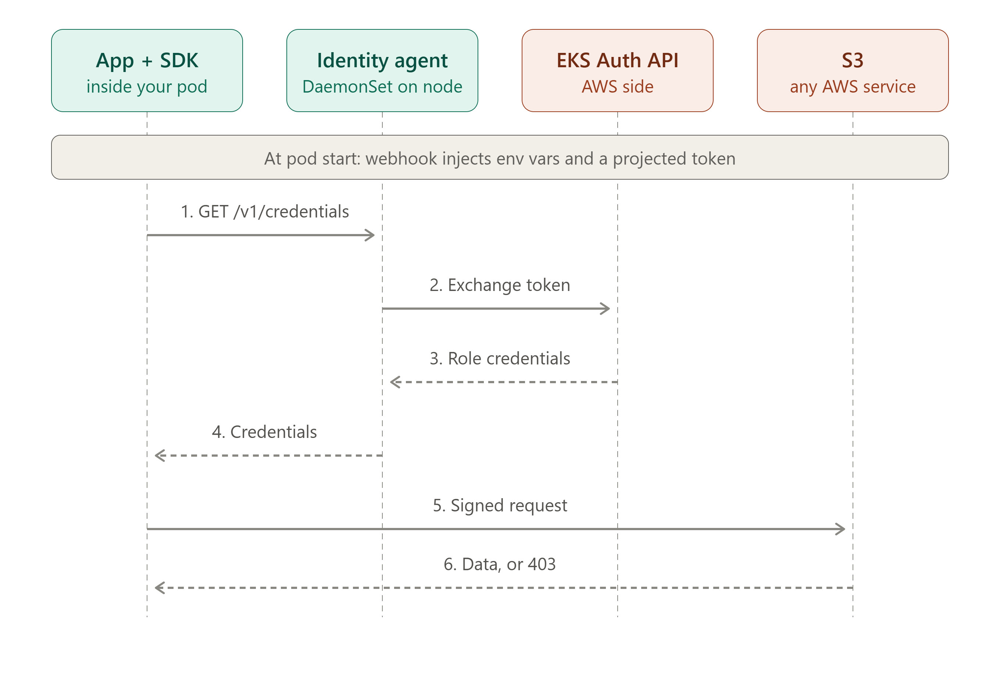

# AWS EKS Pod Identity — Complete Guide

> A comprehensive reference for understanding, implementing, and comparing Pod Identity on Amazon EKS. Built for interview prep and quick revision.

---

## Table of Contents

1. [What is Pod Identity?](#1-what-is-pod-identity)
2. [Purpose of Pod Identity](#2-purpose-of-pod-identity)
3. [What Problem Does It Solve and How?](#3-what-problem-does-it-solve-and-how)
4. [Implementation](#4-implementation)
   - [4.1 Creating an EKS Cluster](#41-creating-an-eks-cluster)
   - [4.2 Necessary IAM Permissions](#42-necessary-iam-permissions)
   - [4.3 Pod Identity Implementation](#43-pod-identity-implementation)
5. [Request Flow — How Authentication Works End-to-End](#5-request-flow--how-authentication-works-end-to-end)
6. [Pod Identity vs IRSA — Detailed Comparison](#6-pod-identity-vs-irsa--detailed-comparison)
7. [When to Use What](#7-when-to-use-what)
8. [Quick Revision Cheat Sheet](#8-quick-revision-cheat-sheet)

---

## 1. What is Pod Identity?

**EKS Pod Identity** is an AWS-native feature (launched at re:Invent 2023) that lets Kubernetes pods assume IAM roles without managing OIDC providers or annotating service accounts with ARNs. AWS runs a small agent (the **Pod Identity Agent**) as a DaemonSet on every node, and that agent transparently provides short-lived AWS credentials to any pod whose Kubernetes service account has been mapped to an IAM role through the EKS API.

In short: Pod Identity is the *next-generation* mechanism for granting AWS permissions to workloads running inside EKS. It replaces much of the manual wiring that IRSA (IAM Roles for Service Accounts) required.

---

## 2. Purpose of Pod Identity

The core purpose is to **give individual Kubernetes pods their own scoped AWS IAM identity** so that:

- **No long-lived credentials exist.** Pods never store access keys; credentials are temporary and auto-rotated.
- **Blast radius is minimised.** Each pod (or group of pods sharing a service account) gets only the permissions it needs — not the broad permissions of the EC2 node it runs on.
- **Operational overhead drops.** Cluster administrators don't have to create or maintain OIDC identity providers, craft complex IAM trust policies with OIDC conditions, or coordinate annotation strings between Terraform and Helm charts.
- **Multi-cluster management becomes simpler.** A single IAM role can be associated with service accounts across many clusters via the EKS API, rather than duplicating OIDC-per-cluster trust policies.

---

## 3. What Problem Does It Solve and How?

### The Problem (Before Pod Identity)

| Challenge | Explanation |
|---|---|
| **Node-level over-privilege** | Without per-pod identity, every pod on a node shares the node's IAM instance profile. A compromised logging sidecar could call S3, DynamoDB, or Secrets Manager with the same permissions as a payment service. |
| **Secret sprawl** | Teams hard-coded AWS access keys into container environment variables, ConfigMaps, or Kubernetes Secrets. Rotating those keys across dozens of microservices was painful and error-prone. |
| **IRSA complexity** | IRSA solved the identity problem but introduced operational friction: you had to create an OIDC identity provider per cluster, craft trust policies with `StringEquals` conditions on OIDC subject claims, and annotate every service account with `eks.amazonaws.com/role-arn`. One typo in an OIDC thumbprint or condition key broke authentication silently. |
| **Cross-account pain** | With IRSA, cross-account role assumption required the target account to trust the source cluster's specific OIDC URL, tightly coupling infrastructure. |

### How Pod Identity Solves It

1. **The EKS Pod Identity Agent** runs on each node as an EKS add-on (a DaemonSet). It intercepts credential requests from the AWS SDK inside the pod by listening on a link-local address (`169.254.170.23:80`).
2. **Associations are declarative.** You call `aws eks create-pod-identity-association` to map: *"Service account X in namespace Y of cluster Z → IAM Role R"*. That's it — no OIDC provider, no annotation, no trust-policy gymnastics.
3. **Trust policy is generic.** The IAM role's trust policy trusts the Pod Identity service principal (`pods.eks.amazonaws.com`) once. The same role works across any cluster without editing the trust policy again.
4. **Credential chain is automatic.** The AWS SDK's default credential chain picks up the injected environment variables (`AWS_CONTAINER_CREDENTIALS_FULL_URI` and `AWS_CONTAINER_AUTHORIZATION_TOKEN`), contacts the agent, and receives temporary `AssumeRole` credentials. Application code needs zero changes.

---

## 4. Implementation

### 4.1 Creating an EKS Cluster

You can create an EKS cluster using `eksctl`, the official CLI tool for Amazon EKS.

**Cluster configuration file — `cluster.yaml`:**

```yaml
apiVersion: eksctl.io/v1alpha5
kind: ClusterConfig

metadata:
  name: my-pod-identity-cluster
  region: ap-south-1       # change to your region
  version: "1.31"          # use a recent supported version

iam:
  withOIDC: false          # Pod Identity does NOT need an OIDC provider

managedNodeGroups:
  - name: ng-1
    instanceType: t3.medium
    desiredCapacity: 2
    minSize: 1
    maxSize: 3
    volumeSize: 20

addons:
  - name: eks-pod-identity-agent   # installs the DaemonSet automatically
```

**Create the cluster:**

```bash
eksctl create cluster -f cluster.yaml
```

This single command provisions the VPC, subnets, the EKS control plane, a managed node group, and — critically — the **eks-pod-identity-agent** add-on.

**Verify the cluster and add-on:**

```bash
# Confirm cluster is active
aws eks describe-cluster --name my-pod-identity-cluster --query "cluster.status"

# Confirm the Pod Identity Agent add-on is running
aws eks describe-addon --cluster-name my-pod-identity-cluster \
  --addon-name eks-pod-identity-agent --query "addon.status"

# Check agent pods on every node
kubectl get pods -n kube-system -l app.kubernetes.io/name=eks-pod-identity-agent
```

---

### 4.2 Necessary IAM Permissions

The IAM user or role that creates the cluster and configures Pod Identity needs the following policies attached.

| Policy | Why It's Needed |
|---|---|
| `AmazonEC2FullAccess` | Creating and managing VPCs, subnets, security groups, and node-group EC2 instances. |
| `AWSCloudFormationFullAccess` | `eksctl` uses CloudFormation stacks under the hood to provision infrastructure. |
| `IAMFullAccess` | Creating the cluster service role, node role, and pod-identity-associated IAM roles. |
| `AmazonEKSClusterPolicy` | Core EKS control-plane permissions. |
| `AmazonEKSServicePolicy` | Allows EKS to manage AWS resources on your behalf. |

**Custom policy for EKS API and SSM access:**

```json
{
  "Version": "2012-10-17",
  "Statement": [
    {
      "Effect": "Allow",
      "Action": "eks:*",
      "Resource": "*"
    },
    {
      "Effect": "Allow",
      "Action": [
        "ssm:GetParameter",
        "ssm:GetParameters"
      ],
      "Resource": "arn:aws:ssm:*:*:parameter/aws/service/*"
    }
  ]
}
```

The `eks:*` permission covers `create-pod-identity-association`, `list-pod-identity-associations`, and every other EKS API call. The SSM actions allow `eksctl` to look up the latest EKS-optimised AMI ID from the AWS Systems Manager Parameter Store.

---

### 4.3 Pod Identity Implementation

#### 4.3.1 The Idea

Instead of each pod relying on the node's instance profile (broad permissions) or embedding static credentials (a security risk), Pod Identity gives every Kubernetes service account a direct, declarative link to an IAM role. The mapping lives in the EKS API, not inside Kubernetes manifests or IAM trust-policy conditions. The Pod Identity Agent on the node transparently brokers short-lived credentials.

#### 4.3.2 How It Works (Mechanism)

1. **Install the agent.** The `eks-pod-identity-agent` add-on deploys a DaemonSet. Each agent pod opens a listener at `169.254.170.23:80` (a link-local address reachable only from pods on the same node).
2. **Create an IAM role with a Pod Identity trust policy.** The trust policy is simple and cluster-agnostic:

```json
{
  "Version": "2012-10-17",
  "Statement": [
    {
      "Effect": "Allow",
      "Principal": {
        "Service": "pods.eks.amazonaws.com"
      },
      "Action": [
        "sts:AssumeRole",
        "sts:TagSession"
      ]
    }
  ]
}
```

3. **Attach a permissions policy** (e.g., `AmazonS3ReadOnlyAccess`) to that role.
4. **Create the association** using the EKS API:

```bash
aws eks create-pod-identity-association \
  --cluster-name my-pod-identity-cluster \
  --namespace default \
  --service-account-name my-app-sa \
  --role-arn arn:aws:iam::123456789012:role/my-pod-identity-role
```

5. **Create the Kubernetes service account** (if it doesn't already exist):

```yaml
apiVersion: v1
kind: ServiceAccount
metadata:
  name: my-app-sa
  namespace: default
```

6. **Deploy a pod that uses the service account:**

```yaml
apiVersion: v1
kind: Pod
metadata:
  name: my-app
  namespace: default
spec:
  serviceAccountName: my-app-sa
  containers:
    - name: app
      image: amazon/aws-cli:latest
      command: ["sleep", "infinity"]
```

7. **Verify credentials inside the pod:**

```bash
kubectl exec -it my-app -- aws sts get-caller-identity
```

The output should show the assumed role ARN (`my-pod-identity-role`), confirming that the pod is not using the node's instance profile.

#### 4.3.3 Step-by-Step Implementation Summary

```
Step 1  →  Create the EKS cluster with the pod-identity-agent add-on
Step 2  →  Create an IAM role with the pods.eks.amazonaws.com trust policy
Step 3  →  Attach the desired permissions policy to that role
Step 4  →  Create a pod identity association (cluster + namespace + SA → role)
Step 5  →  Create a Kubernetes ServiceAccount with the matching name/namespace
Step 6  →  Deploy workloads referencing that ServiceAccount
Step 7  →  Validate with `aws sts get-caller-identity` from inside the pod
```

---

## 5. Request Flow — How Authentication Works End-to-End

Below is the complete flow when application code inside a pod calls an AWS service (e.g., `s3:GetObject`).

```
┌─────────────────────────────────────────────────────────────────────┐
│                        KUBERNETES NODE                              │
│                                                                     │
│  ┌──────────────────────┐         ┌──────────────────────────────┐  │
│  │      APP POD         │         │  EKS POD IDENTITY AGENT      │  │
│  │                      │         │  (DaemonSet on every node)   │  │
│  │  1. AWS SDK needs    │         │                              │  │
│  │     credentials      │  ──②──▶│  3. Agent receives request   │  │
│  │                      │         │     at 169.254.170.23:80     │  │
│  │  2. SDK reads env:   │         │                              │  │
│  │     AWS_CONTAINER_   │         │  4. Agent looks up the pod's │  │
│  │     CREDENTIALS_     │         │     service account and      │  │
│  │     FULL_URI         │         │     matches it to the        │  │
│  │     (points to the   │         │     association registered   │  │
│  │      agent)          │         │     in the EKS API           │  │
│  │                      │         │                              │  │
│  │  8. SDK receives     │         │  5. Agent calls AWS STS      │  │
│  │     temporary creds  │◀──⑦──  │     AssumeRole for the       │  │
│  │     (AccessKeyId,    │         │     mapped IAM role          │  │
│  │     SecretAccessKey, │         │                              │  │
│  │     SessionToken)    │         └──────────────┬───────────────┘  │
│  │                      │                        │                  │
│  └──────────┬───────────┘                        │ ⑤                │
│             │                                    ▼                  │
│             │                         ┌─────────────────────┐       │
│             │                         │    AWS STS           │       │
│             │                         │                     │       │
│             │                         │  6. STS validates   │       │
│             │                         │     trust policy    │       │
│             │                         │     (Principal:     │       │
│             │                         │     pods.eks.       │       │
│             │                         │     amazonaws.com)  │       │
│             │                         │     and returns     │       │
│             │                         │     temp creds      │       │
│             │                         └─────────────────────┘       │
│             │ ⑧                                                     │
└─────────────┼───────────────────────────────────────────────────────┘
              │
              │  9. SDK uses temp credentials to sign the API request
              ▼
    ┌─────────────────────┐
    │   AWS SERVICE        │
    │   (S3, DynamoDB,     │
    │    Secrets Manager)  │
    │                      │
    │  10. Service checks  │
    │      IAM policy on   │
    │      the assumed     │
    │      role and        │
    │      allows/denies   │
    │      the action      │
    └─────────────────────┘
```

### Flow in Words

1. **Application code** inside the pod calls an AWS SDK method (e.g., `s3.getObject()`).
2. **The SDK's credential chain** finds `AWS_CONTAINER_CREDENTIALS_FULL_URI` in the pod's environment (injected by the Pod Identity Agent via a mutating webhook).
3. **The SDK calls the agent** at `http://169.254.170.23:80/...` with the pod's authorization token.
4. **The agent identifies the pod** — it knows which service account the pod runs as and looks up the pod identity association cached from the EKS API.
5. **The agent calls STS `AssumeRole`** for the IAM role that is associated with that service account and namespace.
6. **STS validates the trust policy** (the principal `pods.eks.amazonaws.com` must be allowed) and returns temporary credentials (access key, secret key, session token) that expire after a configurable duration.
7. **The agent returns the temporary credentials** to the SDK inside the pod.
8. **The SDK caches the credentials** and auto-refreshes them before they expire.
9. **The SDK signs the actual AWS API request** (e.g., SigV4 for S3) using those temporary credentials.
10. **The target AWS service** (S3, DynamoDB, etc.) evaluates the IAM policies attached to the assumed role and returns the result.




**Key takeaway:** The application code never handles credentials explicitly. Everything happens transparently through the SDK's default credential provider chain.

---

## 6. Pod Identity vs IRSA — Detailed Comparison

| Aspect | IRSA (IAM Roles for Service Accounts) | Pod Identity |
|---|---|---|
| **Release** | 2019 | 2023 (re:Invent) |
| **OIDC Provider** | Required — one per cluster, must be created and its thumbprint maintained | Not required |
| **IAM Trust Policy** | Complex — must include OIDC URL, condition keys for namespace and service account name | Simple — just trust `pods.eks.amazonaws.com`, no per-cluster or per-SA conditions |
| **Service Account Annotation** | Required: `eks.amazonaws.com/role-arn: arn:aws:iam::...` | Not required — mapping is external via the EKS API |
| **Where the Mapping Lives** | Split across IAM trust policy + Kubernetes annotation | Single place: EKS Pod Identity Association API |
| **Multi-Cluster Reuse** | Each cluster needs its own OIDC URL in the trust policy | Same IAM role works across any cluster without editing the trust policy |
| **Cross-Account Access** | Target account must trust the source cluster's OIDC URL | Target account trusts `pods.eks.amazonaws.com`; simpler |
| **Credential Delivery** | Projected service account token (JWT) mounted into the pod; SDK exchanges it for STS credentials | Agent on node provides credentials at a link-local HTTP endpoint |
| **Agent / DaemonSet** | No extra agent needed | Requires the `eks-pod-identity-agent` add-on (DaemonSet) |
| **Session Tags** | Not supported | Supports session tags (e.g., cluster name, namespace) for ABAC policies |
| **EKS Cluster Types** | Works on EKS, EKS Anywhere, self-managed k8s (with manual OIDC setup) | EKS managed clusters only (not EKS Anywhere or self-managed) |
| **Fargate** | Supported | Not supported (no node to run the DaemonSet agent) |
| **Setup Complexity** | Medium-high (OIDC + trust conditions + annotation) | Low (one API call per association) |
| **Debugging** | Harder — OIDC thumbprint rotation failures, trust-policy typos | Easier — `aws eks list-pod-identity-associations` shows everything |

### How IRSA Works (for contrast)

1. An OIDC identity provider is created and registered with IAM for the cluster.
2. The IAM role's trust policy includes conditions like:
   ```json
   "Condition": {
     "StringEquals": {
       "oidc.eks.region.amazonaws.com/id/CLUSTER_ID:sub": "system:serviceaccount:NAMESPACE:SA_NAME"
     }
   }
   ```
3. The Kubernetes service account is annotated with the role ARN.
4. When a pod starts, EKS mounts a projected service account JWT into the pod.
5. The AWS SDK exchanges that JWT for STS credentials via `AssumeRoleWithWebIdentity`.

### How Pod Identity Works (recap)

1. The Pod Identity Agent add-on runs on every node.
2. An association is created via the EKS API (cluster + namespace + service account → IAM role).
3. The trust policy simply allows `pods.eks.amazonaws.com`.
4. The agent intercepts credential requests and returns temporary STS credentials. No OIDC, no annotation.

---

## 7. When to Use What

### Use Pod Identity when…

- You are running workloads on **EKS managed clusters** with EC2 node groups.
- You want the **simplest setup** with the least moving parts.
- You manage **many clusters** and don't want to maintain an OIDC provider (and its thumbprint) per cluster.
- You need **session tags** for attribute-based access control (ABAC).
- You want a **single source of truth** for service-account-to-role mappings (the EKS API).
- You are starting a **new greenfield project** and can pick the modern approach.

### Use IRSA when…

- You run workloads on **EKS Fargate** (Pod Identity agent can't run as a DaemonSet on Fargate).
- You use **EKS Anywhere** or **self-managed Kubernetes** where the Pod Identity Agent isn't available.
- Your organization already has mature IRSA automation (Terraform modules, Helm charts with annotations) and migration cost outweighs the benefit.
- You need to support **mixed environments** (some clusters are EKS-managed, some are self-hosted) with a single identity model.

### Can they coexist?

Yes. On the same EKS cluster, some service accounts can use Pod Identity while others continue using IRSA. If both are configured for the same service account, **Pod Identity takes precedence**.

---

## 8. Quick Revision Cheat Sheet

```
Pod Identity in one line:
  "Map a Kubernetes service account to an IAM role via the EKS API;
   the on-node agent handles the rest."

Three things you DON'T need with Pod Identity:
  1. OIDC identity provider
  2. Complex IAM trust-policy conditions
  3. Service account annotations

Trust policy (memorise this):
  Principal → pods.eks.amazonaws.com
  Actions   → sts:AssumeRole, sts:TagSession

Create association CLI:
  aws eks create-pod-identity-association \
    --cluster-name CLUSTER \
    --namespace NAMESPACE \
    --service-account-name SA \
    --role-arn ROLE_ARN

Credential delivery:
  Pod → 169.254.170.23 (agent) → STS AssumeRole → temp creds back to pod

Pod Identity wins over IRSA:
  Simpler setup, no OIDC, multi-cluster reuse, session tags

IRSA wins over Pod Identity:
  Fargate, EKS Anywhere, self-managed clusters
```

---

*Last updated: November 2026. Based on AWS documentation and hands-on implementation.*